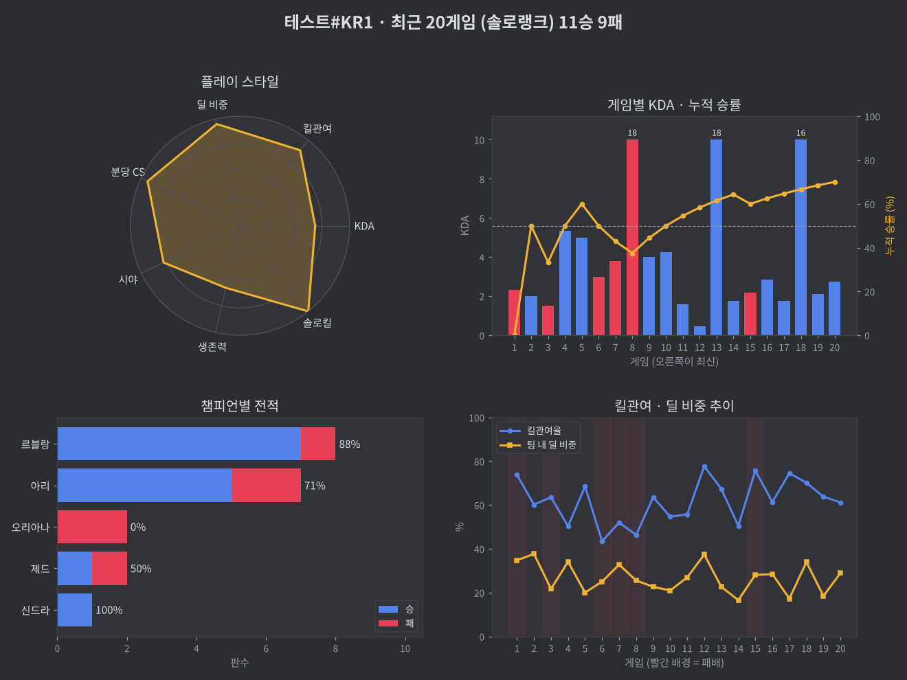

# LoL Stats Discord Bot

리그 오브 레전드 플레이어의 전적과 플레이 스타일을 디스코드 채널에서 바로 보여주는 봇입니다.
친구들과 함께 쓰는 소규모 디스코드 서버용 개인(비상업) 프로젝트입니다.


<sub>※ 예시 이미지는 가짜 데이터로 그린 것입니다.</sub>

## 기능

| 명령어 | 설명 |
|---|---|
| `/전적 닉네임#태그` | 솔로/자유랭크 티어, 최근 게임 승률, 평균 KDA, 킬관여율, 분당 CS, 모스트 챔피언, 주 포지션, 플레이 스타일 태그 |
| `/그래프 닉네임#태그` | 플레이 스타일 레이더 차트, 게임별 KDA·누적 승률, 챔피언별 전적, 킬관여·딜 비중 추이를 이미지로 표시 |

| `/등록 닉네임#태그` | 내 롤 계정 등록 → 이후 `/전적`, `/그래프`에서 닉네임을 비우면 내 계정 조회 |
| `/등록해제` | 등록한 내 계정 삭제 |
| `/기록삭제 닉네임#태그` | 서버 검색 기록에서 닉네임 삭제 |

`/전적`, `/그래프`는 `큐`(솔로랭크 / 자유랭크 / 전체)와 `게임수`(최대 20) 옵션을 지원합니다.
태그를 생략하면 `KR1`로 검색합니다.

### 닉네임 자동완성
한 번 조회에 성공한 닉네임은 서버별로 `data/history.json`에 저장됩니다.
닉네임 칸에 몇 글자만 입력하면 이전에 검색한 닉네임이 최근 검색순으로 추천되고,
등록한 내 계정은 ⭐로 맨 위에 표시됩니다. (`data/`는 `.gitignore`에 포함)

## 사용하는 Riot API

- **ACCOUNT-V1** — Riot ID → PUUID 변환
- **LEAGUE-V4** — PUUID로 랭크 정보 조회
- **MATCH-V5** — 최근 매치 ID 목록, 매치 상세
- **Data Dragon** — 챔피언 한글 이름

한국 서버(`kr` / `asia`)만 사용합니다.

### 요청 관리 / 데이터 처리
- 사용자가 명령어를 입력할 때만 API를 호출합니다.
- 끝난 매치 데이터는 24시간, 그 외 응답은 몇 분 동안 메모리에 캐시해 요청 수를 줄입니다.
- `429 Too Many Requests` 응답은 `Retry-After` 만큼 기다렸다가 재시도합니다.
- 데이터를 영구 저장하거나 외부에 공유하지 않으며, 공개되지 않은 정보(숨겨진 MMR 등)는 표시하지 않습니다.

## 설치 및 실행 (Windows)

```powershell
git clone <이 저장소 주소>
cd <저장소 폴더>
py -m venv venv
.\venv\Scripts\Activate.ps1
pip install -r requirements.txt
```

`.env.example`을 복사해 `.env`로 이름을 바꾸고 값을 채웁니다.

```
DISCORD_TOKEN=디스코드_봇_토큰
RIOT_API_KEY=RGAPI-...
GUILD_ID=서버_ID (선택)
```

```powershell
py bot.py
```

### 디스코드 봇 권한
OAuth2 URL Generator에서 scope `bot`, `applications.commands`,
권한 `Send Messages`, `Embed Links`, `Attach Files`를 선택해 서버에 초대합니다.

## 파일 구조

```
bot.py            디스코드 봇, Riot API 호출, 전적 분석
charts.py         matplotlib 그래프 생성
history.py        검색 기록·내 계정 저장 (data/history.json)
requirements.txt  필요한 라이브러리
.env.example      환경 변수 예시 (.env는 커밋하지 않음)
docs/             README용 이미지
```

## 고지

This project isn't endorsed by Riot Games and doesn't reflect the views or opinions of Riot Games or anyone officially involved in producing or managing Riot Games properties. Riot Games, and all associated properties are trademarks or registered trademarks of Riot Games, Inc.
